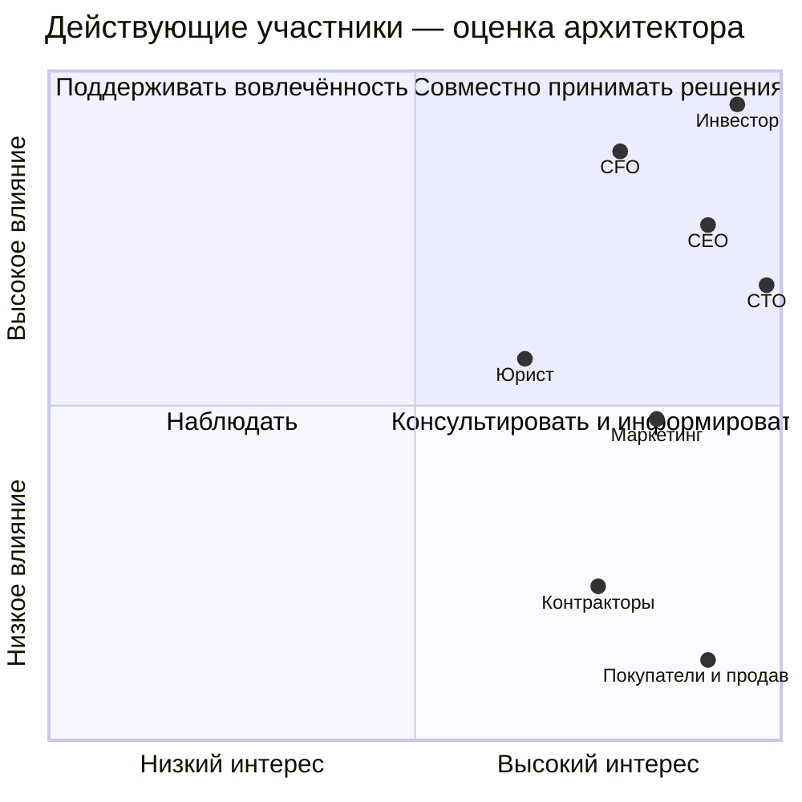

# Карта стейкхолдеров

**Решающий голос по сроку, рынкам и объёму инвестиций — у К. Орлова.** Он делегировал технологические решения CTO и архитектору, но потребовал не спорить с финансовыми ограничениями CFO (А1, диалог о технологии и деньгах). Это не даёт CTO права самостоятельно расширить бюджет или штат. Юридические обязательства не снимаются решением инвестора; письмо юриста пока предварительное (А3).

Предлагаемый порядок разрешения конфликтов: выяснить обязательные правовые ограничения с юристом → проверить бюджет с CFO → согласовать продуктовый компромисс с CEO → вынести изменение срока, scope или финансирования инвестору. Технический вариант выбирают CTO и архитектор внутри согласованных границ. Это предлагаемая модель управления, требующая подтверждения на встрече.

| Участник | Интерес | Влияние / интерес | Приоритет и роль при конфликте | Предпочтительная коммуникация |
|---|---|---|---|---|
| К. Орлов, инвестор | Запуск 15.10, рост, выплаты продавцам, отсутствие сбоев | Высокое / высокий | **P1:** окончательный бизнес-арбитр; изменение бюджета согласует с CFO. Не может отменить закон | Одна страница с решением и ценой компромисса; на встрече один слайд. Просьба о странице — А1 |
| Анна Вебер, CFO | Runway, лимит $5000/мес., стоимость заказа, комиссия платежей | Высокое / высокий | **P1 в финансах:** предварительно согласует статью >$500/мес.; блокирует необеспеченные расходы и найм | До встречи: TCO на 5 лет, unit economics, цена ошибки, котировка и альтернатива — А6 |
| Марк Лефевр, CEO | Работающий рыночный пилот, реалистичный scope | Высокое / высокий | **P2:** предлагаемый владелец MVP вместо ушедшего PM; готовит бизнес-компромисс инвестору | Короткое обсуждение сценариев покупателя и продавца, критериев успеха — А1, контекст |
| Раджеш Менон, CTO | Масштаб, надёжность, переносимость, контроль над технологиями | Высокое / высокий | **P2 в технике:** совместное решение с архитектором в рамках бюджета; технологические предпочтения не выше ограничений CFO | Черновик ADR до Найроби; сравнение вариантов по одинаковым критериям — А5 |
| София Алмейда, маркетинг | Выполнение оплаченных обещаний, конверсия, запуск кампании | Среднее / высокий | **P3:** владелец рекламных обещаний; не утверждает единолично scope и использование персональных данных | Таблица «обещание → возможность MVP → разрыв → действие», совместно с CEO — А2 |
| Адаезе Нвосу, внешний юрист | Допустимая обработка данных, лицензии, ответственность | Среднее / высокий | **P1 по правовой экспертизе:** определяет основания и неопределённость; технические решения принимает команда | Письменные вопросы по конкретным категориям данных и потокам; оплачиваемая консультация — А3 |
| Архитектор решения | Согласованность требований, обоснованные компромиссы, обратимость | Среднее / высокий | **P2 консультативный:** формирует варианты и последствия; не выдаёт собственное допущение за бизнес-одобрение | Реестр конфликтов, Canvas, затем ADR и расчёты — контекст, А5–6 |
| Шесть контракторов | Выполнимый объём, понятные границы, поддерживаемость | Низкое / высокий | **P3:** оценивают трудоёмкость и эксплуатационную нагрузку; не меняют приоритеты бизнеса | Проверка оценок и распределения ответственности; компетенции ещё неизвестны — А6 |
| Покупатели и продавцы | Доступный канал покупок, доверие, доставка, получение денег | Низкое / высокий | **P3:** источник валидации ценности; их интересы представляет CEO, пока прямой контакт не организован | Короткие интервью и проверка сценариев, если разрешены; запрет интервью инвестором нужно пересмотреть — А1–2 |
| Регуляторы; платёжные и логистические партнёры | Законность; договорные и технические условия интеграций | Высокое / не установлен | **Внешние ограничения:** разрешения и условия партнёров могут блокировать запуск независимо от внутренних приоритетов | Регуляторы — через юриста; партнёры — письменные условия, SLA и sandbox — А3, контекст |
| Том Брэдли, бывший PM | Зафиксированный им scope | Нет текущего / не установлен | **P4:** исторический источник, а не действующий согласующий; ушёл 04.08 | Использовать список как вход для оценки, не ожидать согласования — А4, состав участников |

## Влияние и интерес

## Assumptions

Влияние и интерес — качественная оценка архитектора, координаты не являются измеренными величинами. Каналы коммуникации предложены, кроме явно запрошенных в письмах. Внешние стороны и бывший PM не нанесены на диаграмму: их текущий интерес неизвестен. Роль заместителя CTO только предложена; дополнительных полномочий у архитектора пока нет. Источник ролей — состав участников.

Исходник диаграммы: [stakeholder-influence-interest.mmd](stakeholder-influence-interest.mmd). Изображение: [SVG](stakeholder-influence-interest.svg).
