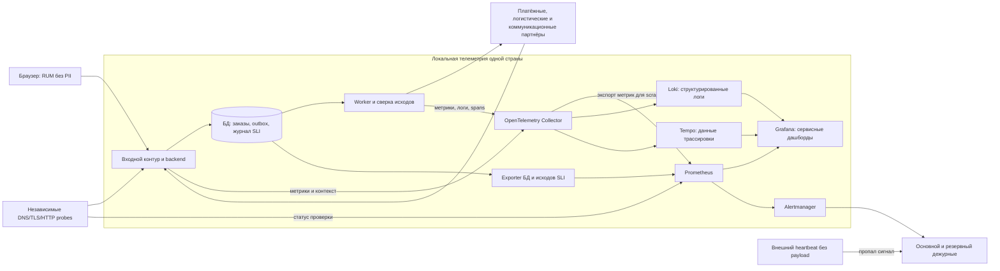

# Наблюдаемость и реагирование

Цель — обнаружить, что покупатель не может купить или получить сведения о заказе, определить участок отказа и безопасно восстановить операцию. Основные дашборды строятся вокруг [каталога](slo/catalog.md), [оплаты](slo/payments.md) и [уведомлений](slo/notifications.md), а не вокруг списка серверов. Источник — артефакт 5, Cloud Native и наблюдаемость; приложение, CN.OBS.01/02.

## Четыре золотых сигнала

Используем latency, traffic, errors, saturation из [Google SRE](https://sre.google/sre-book/monitoring-distributed-systems/). Ниже — конкретизация для MVP, а не дополнительный список технологий.

| Сигнал | Каталог | Оплата | Уведомления | Связь с действиями |
|---|---|---|---|---|
| Задержка | Гистограмма API; P50/P95/P99, время первого товара в RUM | Отдельно собственный API, инициация у партнёра, возраст pending и отражение callback | Время от создания outbox до приёма партнёром; возраст старейшей задачи | CAT-L, PAY-L/E/C, NOT-H; посмотреть трассировку медленной операции, latency БД/партнёра |
| Трафик | RPS по шаблону маршрута, страна, hit/miss | Уникальные платёжные команды, callbacks, запросы сверки; конверсия в paid отдельно | Новые обязательства, попытки отправки, квитанции; по стране/каналу | Не смешивать технические повторы с бизнес-объёмом; сопоставить с квотами и рекламой |
| Ошибки | CAT-A bad: timeout, 5xx, легитимный 429, семантически неверный/слишком старый ответ | PAY-A/E/C bad, ошибки подписи, расхождения денег и заказа | NOT-H bad, DLQ, undelivered и unknown receipts | Бюджет ошибок; инварианты денег — SEV-1 независимо от частоты |
| Насыщение | CPU/RAM, pool wait БД, память кеша и конкурентные наполнения | Семафор партнёра, DB pool, circuit state, pending backlog | Очередь/возраст, лимит провайдера, свободный диск и worker concurrency | Предупреждение до отказа, Bulkhead/backpressure; это ресурсные сигналы, не пользовательские SLI |

Не усреднять P99 между репликами: сначала агрегировать histogram buckets по одинаковым определениям, затем вычислять процентиль. Тайм-аут — плохое событие, даже если его длительность не успела попасть в обычный завершённый span. Увеличение business declines показывается отдельно от технических отказов.

## Схема сбора

Одинаковый стек развёртывается **локально в каждом контуре страны**. Для Нигерии схема целиком остаётся в Нигерии; допустимость экспорта даже агрегатов проверяется отдельно. Распределённая трассировка — запись прохождения операции через компоненты системы. Данные трассировки операции могут содержать идентификаторы пользователя, заказа или платежа, поэтому их нельзя автоматически считать обезличенными.

Синтетические проверки — автоматические проверки, имитирующие действия пользователя. Они проверяют доступность домена, защищённого соединения и выполнение пользовательского сценария извне backend; платёжный probe безопасный, без реального списания, поэтому дополнительно нужны реальные PAY-E и сверка. Heartbeat работает вне отказавшего контура: он обнаружит исчезновение Prometheus/Alertmanager. Канал дежурных независим от провайдера клиентских SMS.

## Достоверность SLI и ограничения телеметрии

1. Счётчики `sli_events_total` содержат `objective`, `country`, ограниченный `provider/channel` и `result=good|bad`. ID пользователя, заказа, телефона, платёжного события и полный URL не являются labels. Нормализованный route — только для технических метрик.
2. У синхронных операций запись входа и запись завершения/тайм-аута сопоставляются. Для unique payment-команды используется журнал дедупликации; внутренний повтор не создаёт новое событие. Для NOT-H deadline evaluator читает **все** обязательства outbox, включая неотправленные, и фиксирует исход ровно один раз.
3. События оцениваются после своего deadline: CAT-A 2 с, PAY-A 2 с, PAY-E 8 с, PAY-C 60 с, NOT-H 5 мин. Окно асинхронных objectives определяется временем оценки; соответствующее смещение относительно входного события фиксировано. Показатели разных deadlines не складываются в один процент. Каждые сутки агрегаты сверяются с локальным журналом исходов.
4. При total=0 отображается «нет событий». При потере heartbeat >2 мин — «данные неполны» и алерт, а не 100%. Потерянные наблюдения восстанавливаются из входного/транзакционного журнала; если это невозможно, отчёт отмечает непроверяемый интервал и SLO не объявляется выполненным. Изменения схемы метрики версионируются, историю нельзя пересчитать новым исключением без пояснения.
5. Для rolling 30d метрики хранятся 35 суток; локальные исходы для сверки — 35 суток, агрегированные суточные итоги — 90 суток. Это технические сроки для измерения, не сроки финансового/юридического хранения; финансовый аудит имеет отдельную политику в задании 4.
6. Логи — структурированные: время UTC, service/module, severity, operation, технический код, случайный trace ID. Без тела запроса, телефона, адреса, токена, PAN и платёжных реквизитов. Необходимая связь с конкретной операцией хранится в ограниченном локальном аудите. Collector применяет allowlist полей; ограниченный буфер не блокирует обработку заказов при отказе наблюдаемости.
7. Trace context передаётся через заголовки и outbox; наружу только согласованные технические заголовки без пользовательского baggage. Для общих успешных запросов — 1% sampling, для исследуемых ошибок — приоритетный сбор в пределах лимита. SLI-счётчики не сэмплируются; даже сбор всех ошибок не обещается при переполнении. Метрика dropped telemetry обязательна.

Бюджет наблюдаемости — **$200/мес.** из TCO, ориентировочно $100 на страну (compute/диск/хранение и доля независимых проверок). Ограничения стартового контура: до 10 тыс. активных рядов на страну, scrape 15 с, логи до 100 МБ/сутки с хранением 7 суток, данные трассировки до 50 МБ/сутки с хранением 3 суток. Это квоты планирования, достаточность подтверждается испытанием. При росте сначала ограничиваются отладочные логи и сбор данных трассировки успешных операций, затем пересматривается бюджет; первичные исходы SLI и финансовый аудит не выбрасываются ради лимита. Jaeger из предложения CTO заменён Tempo как единым просмотром с Grafana; ELK не добавляется без необходимости.

## Алерты и действия

Для каждого объектива отдельно: `bad_ratio = bad / (good + bad)`; `burn_rate = bad_ratio / (1 − target)`. Все окна считаются по стране и каналу, без глобального сглаживания. Базовые многоконные правила адаптированы из [Google SRE Workbook](https://sre.google/workbook/alerting-on-slos/); значения политики ниже требуют настройки по фактическому трафику.

| Условие | Срочность | Действие |
|---|---|---|
| Burn rate >14,4 одновременно за 1 ч и 5 мин | Вызов дежурного | Быстрый расход около 2% 30-дневного бюджета за час; проверить пользовательский путь и недавний deploy |
| Burn rate >6 одновременно за 6 ч и 30 мин | Вызов дежурного | Устойчивая деградация; проверить провайдера, saturation и очередь |
| Burn rate >1 одновременно за 3 суток и 6 ч | Задача владельцу в рабочее время | Медленное исчерпание; план исправления и оценка риска релизов |
| Два последовательных подтверждённых минутных probe-отказа либо любое расхождение денежного инварианта | SEV-1 независимо от объёма | Ограничить затронутую запись, сохранить чтение/сверку, назначить руководителя инцидента |
| PAY pending >15 мин, NOT backlog >5 мин, существенное падение delivery receipts | SEV-2 | Сверка/очередь ручной проверки, проверка квоты и партнёра; не списывать повторно вслепую |
| Нет heartbeat/метрик >2 мин; WAL-копия старше 5 мин | Отдельный вызов дежурного | Восстановить наблюдаемость/копирование; явно отметить неподтверждённый SLO или потерю целевого RPO |

Burn-rate page применяется при ≥20 событиях в длинном окне; при меньшем трафике дополнительно действуют абсолютные сигналы: ≥3 технических неуспехов за 15 мин — проверка дежурным, независимо от burn rate. Ни один денежный инвариант не ждёт порога 20. При отсутствии реального трафика доступность контролируют синтетические проверки; их результаты не включаются в знаменатель SLI реальных пользовательских операций. Для NOT-H алерт неизбежно отстаёт от создания обязательства до пяти минут; ранний сигнал — возраст очереди >2 мин.

**SEV-1:** основной дежурный подтверждает ≤5 мин; если нет — немедленно резервный и CTO. В течение 10 мин определяется руководитель инцидента и безопасное действие: откат, отключение проблемного канала, ограничение записи. Обновление CEO/операций каждые 15 мин. **SEV-2:** подтверждение ≤30 мин, план действий ≤2 ч; при влиянии на покупку повышается до SEV-1. Наблюдаемость не обеспечивает эти сроки без назначенной основной/резервной смены; расписание — условие запуска, подробная организация в задании 5.

Восстановление проверяется реальным smoke-сценарием и отсутствием нарушений целостности. Завершение аварии не стирает потраченный бюджет. Политика ограничения релизов и post-mortem — [экономика доступности](availability-economics.md).

## Assumptions

Стек остаётся внутри бюджетного конверта, только если подтверждены котировки и объёмы; инструменты не являются доказательством полноты мониторинга. Нигерийские логи, данные трассировки и журнал SLI остаются в стране; сквозной общий dashboard получает только согласованные агрегаты либо используется локально. Для файлов с PII применяются требования задания 4. Действующие договоры провайдеров, состав дежурных и реализация метрик пока не подтверждены; этот документ задаёт требования и проектную схему.

Исходник диаграммы: [observability.mmd](observability.mmd). Изображение: [SVG](observability.svg).
