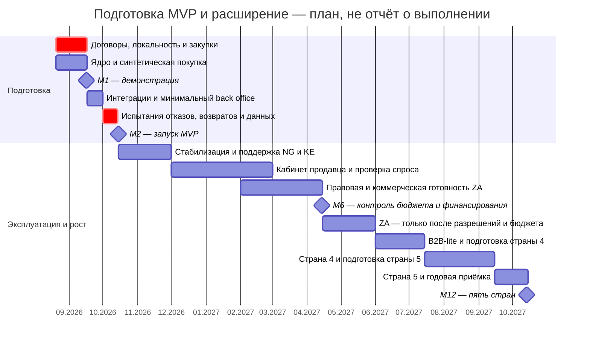

# Roadmap и граница MVP

**Дата запуска: 15.10.2026.** Для календаря принят старт восьминедельного окна 20.08.2026; это плановая дата, не факт найма. М1/М2 — первый и второй месяцы подготовки. М6/М12 — шестой и двенадцатый месяцы **эксплуатации после запуска**, как в TCO. Поэтому М6 — 14.04.2027, М12 — 14.10.2027; шкалы не смешиваются.

## Контрольные точки

| Точка | Scope и критерий готовности | Команда | Технические расходы / месяц |
|---|---|---|---|
| М1, 16.09.2026 | Синтетическая покупка: каталог → заказ → sandbox оплаты → статус доставки. Локальные NG/KE-стенды, CI/CD, базовые права, договорные заявки, первый набор продавцов без загрузки непроверенных данных | Шесть контракторов; CEO владелец продукта, CTO техническая приёмка. База работ 14 эффективных чел.-нед. | Предпроизводственный лимит $1200 до резерва, **$1380** с 15%; это оценка, общие инструменты входят, реальные сообщения ограничены тестами |
| М2, 15.10.2026 — MVP | 8 сокращённых пунктов PM; 5000 SKU/100 продавцов NG+KE, сквозная покупка, проверяемые возвраты, базовый back office и отчёт CEO. Пройдены приёмочные условия ниже | Те же шесть; база ещё 14 недель, до 6 недель резерва на неопределённость, 2 свободные. Дежурство включено | Полный фиксированный контур $2800; run-rate первого эксплуатационного месяца при 10 тыс. заказов **$3795** с сообщениями/резервом |
| М6, 14.04.2027 | Стабилизация NG/KE; базовый кабинет продавца, доказанный спрос на один дополнительный канал/язык; подготовлены договоры и юридический пакет ZA. Production ZA ещё не включён в шестимесячный лимит | Шесть, без предположения о найме после декабря; приоритет эксплуатации и задолженности по качеству | При 20 тыс. заказов **$4370**. Запуск третьего контура по $900 дал бы $5405, нарушив лимит; поэтому только подготовка и синтетические тесты в существующем стендовом конверте |
| М12, 14.10.2027 | Пять стран: NG, KE, ZA и две выбранные по рыночным/правовым критериям; B2B-lite без собственного кредита; кабинет продавца, договорные интеграции. Цель >1 млн пользователей проверяется фактом, не считается доказанной архитектурой | Шесть по TCO года 1. Одновременно не более одной новой страны или крупной функции; при нехватке мощности меняются сроки/scope | База Task2 для 100 тыс. заказов **$8970** не включает доказанную цену трёх новых локальных контуров. Дополнительный сценарий ниже: **$12 075** с резервом; нужен новый бюджет |

Техническая стоимость не включает ФОТ, маркетинг, бизнес-операторов, оборотный капитал и перевозку. Комиссии платежей/логистики вынесены из лимита только по принятому допущению CFO. Перерасход не компенсируется средствами $9000 из презентации совета директоров.

Полосы после MVP задают последовательность, а не непрерывную занятость всех инженеров функциональной разработкой. Плановая скорость новых функций — не более 12 эффективных чел.-нед./месяц, остальное время команды поглощают эксплуатация, QA, поддержка и восстановление после дежурств. Первая оценка мощности пересматривается после двух недель фактической работы. Переключение страны на реальные данные проводится только после отдельной приёмки.

## Все 29 пунктов PM

Критерии отбора: **K1** необходим для сквозной покупки; **K2** необходим для права/безопасности/управления деньгами; **K3** помещается в 34 эффективные недели; **K4** есть проверяемый партнёр и бюджет. «Отложено» — не автоматическое обещание реализации к следующей дате. Номера соответствуют порядку в артефакте 4.

| № | Исходная функция | Решение к MVP | Пересмотр / критерий |
|---:|---|---|---|
| 1 | Каталог, неограниченные категории/атрибуты | **Сократить:** 5000 SKU, согласованный справочник категорий/атрибутов | K1/K3; лимиты расширять по фактическому ассортименту |
| 2 | Полнотекстовый поиск с опечатками, 5 языков | **Сократить:** простой поиск/фильтры; без обещания опечаток и 5 языков | K1/K3; М6 — язык и качество поиска по потерянным конверсиям |
| 3 | Голосовой поиск Swahili/Hausa | Отложить | После исследования доступности и стоимости, не ранее М12 |
| 4 | AI-рекомендации | Отложить | Нужны объём данных, эксперимент и измеримый прирост маржи |
| 5 | Live-stream shopping | Отложить | Нет доказанного спроса; нагрузка/модерация не помещаются в MVP |
| 6 | Чат с автопереводом | Отложить | Сначала поддержка через оператора; М6 оценить спрос и обработку PII |
| 7 | Отзывы с фото/видео | Отложить | После готовности модерации; текстовый пилот возможен после М6 |
| 8 | Онбординг только через WhatsApp | Отложить исходную функцию | Вместо неё базовая веб-форма и оператор C01; мессенджер не единственный путь. Пересмотр М6 по продавцам и разрешениям |
| 9 | Онбординг USSD | Отложить | М6: договор с оператором, стоимость сессии и спрос; пилот одного сценария |
| 10 | Кабинет продавца, когорты и прогноз остатков | Отложить исходный пакет | М6 — базовые заказы/остатки; когорты и прогноз не обязательны даже к М12 |
| 11 | M-Pesa, Flutterwave, Paystack, карты, bank transfer, COD | **Сократить:** M-Pesa KE и разрешённые локальные каналы Flutterwave NG | K1/K2/K4; не подключать всех и не включать COD без контроля сверки |
| 12 | BNPL и собственный скоринг | Отложить | Только лицензированный партнёр и отдельная экономика; не обещано на М12 |
| 13 | Мультивалютный кошелёк и P2P | Отложить | Регуляторный/финансовый контур отсутствует; локальная оплата без собственного кошелька |
| 14 | Криптотокен лояльности | Отложить | Вернуть инвестору отдельное решение после проверки пользы, права и стоимости; не включать автоматически |
| 15 | Колесо удачи, daily streaks | Отложить | Эксперимент удержания после стабильной покупки, без отвлечения MVP |
| 16 | Flash sales, таймеры, резервы | Отложить маркетинговую функцию | Технический резерв обычного заказа входит в C03 и не считается реализацией flash sale; сначала нагрузочные испытания |
| 17 | Динамические цены по scraping Jumia | Отложить | Право на данные, экономика и влияние на доверие требуют отдельной проверки |
| 18 | Tracking, живая карта, ETA до минуты | **Сократить:** статусы партнёра и приблизительное окно, без карты/минутной гарантии | K1/K4; точность обещаний ограничена договором перевозчика |
| 19 | ПВЗ с видео каждой передачи | Отложить | Нет собственной сети/основания для видео; М6 исследовать партнёрские ПВЗ без обязательной видеозаписи |
| 20 | 30-дневные возвраты, мгновенные деньги | **Сократить:** регистрация обращения, проверка и возврат через провайдера | K2; срок права на возврат — по утверждённой политике/закону, не отменяется сокращением интерфейса. Мгновенный возврат не обещать |
| 21 | ML-антифрод | Отложить ML | Базовые лимиты, проверки подписи и ручной разбор обязательны в C04/C06; ML — после данных |
| 22 | B2B: опт, quotes, invoices, кредит 30 дней | Отложить | М12 B2B-lite: оптовая заявка/счёт/предоплата; кредит только партнёрский, если одобрен отдельно |
| 23 | Affiliate/referral с выплатами | Отложить | После доказательства стоимости привлечения и безопасной модели выплат |
| 24 | Offline-заказ через USSD/SMS | Отложить | М6 проверить спрос и договоры. PWA-кеш не объявлять поддержкой заказа без сети |
| 25 | PWA + native iOS + native Android с паритетом | **Сократить:** одна адаптивная PWA, кеш публичного контента | K1/K3; native — только при доказанном ограничении PWA |
| 26 | Полный admin back office | **Сократить:** модерация каталога, допуск продавца, заказы/споры/возвраты, аудит | K2; расширять по объёму ручных операций, права разделены |
| 27 | Публичный GraphQL API | Отложить | Внутренние API/адаптеры достаточны; внешний API — по подписанному интеграционному спросу |
| 28 | Real-time executive dashboard | **Сократить:** суточные агрегаты и базовые оперативные статусы | K1 для управления, K3; финансовая сверка отделена от live-счётчика заказов |
| 29 | Dark mode | Отложить | Низкая ценность относительно критического пути; после качества и доступности интерфейса |

Итого: **8 сокращённых (1, 2, 11, 18, 20, 25, 26, 28), 21 отложенный, 0 полных исходных пунктов**. Минимальные IAM, согласия, outbox, резервирование, мониторинг и дежурства — обязательные обеспечивающие работы, а не скрытое выполнение всех 29. Допущения по языку, веб-онбордингу, выплатам, отсутствию USSD и карт курьера должны быть согласованы с CEO/инвестором и отражены в рекламе до запуска.

## Приёмка MVP и решение о запуске

К концу недели 2 — подтверждены роли шести человек и план закупки/партнёров. К концу недели 4 — проверены допустимые платёжные/логистические потоки, all-in-тариф, локальные площадки и пути оплаты по счёту. К неделе 6 — сквозная операция на разрешённых тестовых данных, runbook и подготовленные продавцы. Недели 7–8 — нагрузка, отказы, повторные callbacks, возвраты, удаление после restore и учебное дежурство.

На 14.10 CEO/CTO/DPO/CFO проверяют: соответствие Task3, локальность Task4, безопасную оплату/возврат, готовность доставки, каталог, операторов, дежурство, утверждённую комиссию и бюджет. Не прошедший юридическую/финансовую проверку поток не запускается. Если не готовы обе страны или сквозная оплата, требуется явное решение инвестора о сокращении географии/переносе обещаний; нельзя объявить витрину без покупки принятым MVP двух стран.

## Стоимость пяти стран и финансирование

База Task2 — $2800/мес. фиксированно в год 1, но Task4 не доказал размещение пяти стран за эту сумму. Дополнительное допущение: новый местный контур **$900/мес.** каждый, общие инструменты пока без роста. В М12: `(2800 + 3 × 900 + 100000 × 0,05) ×1,15 = $12 075`. Котировки, трафик и поддержка могут увеличить сумму.

Для сценария включения ZA с эксплуатационного М7, страны 4 с М10 и страны 5 с М12 добавка за год: `900 × (6+3+1) ×1,15 = $10 350`. Это **дельта к модели Task2**, не уже включённый расход. Полный TCO расширения пересчитывается после выбора стран и котировок; исходный пятилетний TCO нельзя выдавать за подтверждённую цену этой новой географии.

Страны 4 и 5 выбираются до М8 по законности потоков, возможности локального размещения, платёжной комиссии, перевозке и спросу. Само наличие страны в API провайдера не считается выходом на рынок. Runway девять месяцев: новый бюджет и финансирование требуются до истечения фактического runway, целевой контроль — М6 эксплуатации или более ранняя дата по CFO; дата начала runway в материалах не указана.

Исходник диаграммы: [roadmap.mmd](roadmap.mmd). Изображение: [SVG](roadmap.svg).
